# Etapa C · Entorno selvático anime: informe técnico

**Fecha:** 30 de octubre de 2026
**Estado:** C3 validada con el personaje en movimiento y pulida, en espera de tu revisión. No está integrada en `main` ni en el mundo principal, y no he empezado otra etapa.

El informe tiene cuatro partes, de la más reciente a la más antigua: **validación y pulido de la C3**, **C3**, **C2** y **C1**. Las capturas de C1, C2 y de la entrega C3 se conservan sin cambios.

---

## Validación y pulido de la C3

**Rama:** `etapa-b-cel-shading-anime` (nada en `main`). **Punto de control** antes de cambiar nada: commit `05dc880` (C3 tal como se entregó en `bf3569a`, ver `PUNTO_CONTROL_C3.md`).

El trabajo se hizo **sobre la misma escena y los mismos archivos de la C3**. No hay escenas, scripts, materiales ni carpetas de una C4. La C2, la C1 y sus comparaciones siguen igual.

### V.1 Cómo se probó con el personaje en movimiento
- La escena C3 tiene ahora un **modo de recorrido** (tecla **C**, o `--jugar` al abrirla). Usa las piezas del juego **tal cual**, sin modificarlas:
  - el Pollo Amarillo jugable `scenes/characters/PlayerCinematic.tscn` (`CinematicPlayer`: caminar 2,3 m/s, correr 4,4 m/s, escalón 0,32 m, giro del cuerpo antes de avanzar);
  - la cámara al hombro del mundo: `DirectorCamaras` con el plano `"hombro"` de `PlanosMundo.build()` (distancia 3,2 m, giro a mano con Q/R, ratón o stick, inclinación con I/K, choque con la capa 1).
- La escena solo hace lo mismo que `Mundo3D`: le da al personaje la zona caminable y, cada fotograma, la base de la cámara.
- Las pruebas y el video conducen al personaje con un **piloto que pulsa las mismas acciones del jugador** (`move_*` relativas a la cámara, `run`, `cam_*`). No hay atajos dentro del controlador.

### V.2 Problemas de colisión y navegación encontrados, y su solución
| # | Problema | Cómo se vio | Solución |
|---|---|---|---|
| 1 | **La C3 no tenía ninguna colisión** (era una escena de capturas). El personaje atravesaba troncos, raíces y rocas, y la cámara no chocaba con nada. | Con las colisiones desactivadas, el personaje llega al **centro** del grupo de rocas, del tronco inclinado, del árbol monumental y del tronco caído (0,34 m: el punto al que se le manda). | Colisión en la capa 1 (la que usan el personaje y la cámara): corteza de cada árbol con su propia malla (tronco, raíces del pie y ramas), raíces del camino, rocas medianas y grandes, tronco caído, tallos de palmas, helechos arborescentes y plataneras, y el suelo. En total, 266 formas (133 árboles, 54 rocas, las raíces, el tronco caído y los tallos), más el suelo. |
| 2 | Las piedrecillas y raíces bajas podían frenar el paso por el camino. | — | Las piedrecillas no tienen colisión. Las raíces bajas se suben como escalones (escalón del juego, 0,32 m). El recorrido entero no tiene ni un atasco. |
| 3 | Las monsteras, arbustos, helechos e hierbas bloquearían el paso si fueran sólidos. | — | Se atraviesan, como vegetación blanda. |
| 4 | **Al hundir más las rocas** (prueba de pulido), la roca grande quedó con pendientes de menos de 50° y el personaje **se subía encima** (1 m de altura). | Prueba de choques: llegaba a 0,35 m del centro de la roca, a 0,95 m de altura. | Descartado: las rocas vuelven a su profundidad original. |
| 5 | Las raíces nuevas hacia las rocas hacían de **escalera** para subirse a ellas. | Igual que el 4, en una primera versión. | Raíces bajas (0,30-0,42 m) y separadas de la roca al menos 0,6 m. |
| 6 | Fuera del camino, el tallo de una platanera o sus hojas se ponen a veces entre la cámara y el personaje. | Entre el 1 y el 5 % de las muestras de cámara en los paseos fuera del camino, según la ejecución; 0 % en el camino. | Se deja así (es breve y fuera del camino). Ver pendientes: depende del director de cámaras, que es un sistema original. |

### V.3 Resultado del recorrido (pruebas automáticas, Godot 4.7.2)
- **Camino entero (96 m)**: 32 m caminando y 64 m corriendo, de z = 10 a z = −86. Llega al final, **0 atascos, 0 rescates**. Velocidad medida: **2,30 m/s** caminando y **4,40 m/s** corriendo (las del juego).
- **Giro**: media vuelta de **171°** en 1 s, girando el cuerpo antes de avanzar.
- **Choques** (caminar directamente contra el obstáculo durante 5 s): se detiene a **1,38 m** del centro del grupo de rocas, **0,99 m** del tronco inclinado, **1,52 m** del árbol monumental y **0,65 m** del tronco caído. **0 fotogramas** con el cuerpo dentro de un obstáculo.
- **24 paseos fuera del camino**, a 4-12 m del eje, entre raíces, rocas y troncos, y vuelta al camino: 0 fotogramas dentro de obstáculos, 0 veces atrapado, 0 rescates.
- **Cámara al hombro en el camino**, 295 muestras: 0 dentro de troncos, rocas o el suelo; **0 con la vista tapada** por troncos, ramas, copas o plantas; 0 pegada al personaje (menos de 1 m). La comprobación de hojas usa los triángulos reales de las copas, y la prueba verifica que detecta una copa cuando la hay.
- **Cámara fuera del camino**, 2 172 muestras en la ejecución final: 0 dentro de obstáculos; vista tapada en el **1,3 %** (28 muestras, sobre todo plataneras). En ejecuciones anteriores llegó al 5 %.
- **Giro manual de la cámara** con el personaje quieto, en 3 sitios del camino: 277° a la izquierda y a la derecha, e inclinación arriba y abajo. 0 fotogramas dentro de obstáculos.
- **Escala:** personaje de 1,45 m, camino de unos 2,6 m de ancho y árbol monumental de 33 m (más de 22 veces la altura del personaje).

### V.4 Pulido visual (sin perjudicar la navegación)
Todos los cambios se comprobaron de nuevo con el recorrido.
- **Copas:** a menos de 7,5 m del camino ya no crecen especies de copa ancha (redonda, en pisos, ceiba). En su lugar van cecropias y árboles jóvenes, de copa alta y estrecha, con una escala máxima de 1,0. El árbol en pisos fijo junto al camino se apartó 3 m: su copa de 6 m lo cubría entero. Se ve más cielo sobre el camino y la mitad superior de la imagen queda menos saturada. El bosque mantiene sus 8 tipos de árbol y su densidad.
- **Troncos claros:** ceiba, higuera monumental y cecropia más oscuras y cálidas, y con algo más de musgo. Ya no se leen como troncos blancos o grises.
- **Roderas:** van a tramos, con separación y ancho que cambian a lo largo del camino y son distintas en cada lado. Antes eran dos líneas paralelas idénticas.
- **Piedrecillas:** en grupos, en dos tamaños, con tono variable y más abundantes hacia la orilla. Antes eran un moteado uniforme.
- **Hojas y musgo:** las hojas caídas se juntan bajo las copas, en dos tonos, y algunas entran desde la orilla al camino. Los charcos de humedad son más suaves.
- **Rocas integradas:** los grupos grandes tienen raíces del árbol más cercano que llegan a la roca y la rodean (72 raíces, antes 56), además del anillo de musgo y tierra húmeda.
- **Noche:** se mantienen la atmósfera azul, la luna, las 220 luciérnagas y la misma exposición que de día. Se añade un **relleno frío y suave sobre el personaje** (luz de la escena, sin sombras, energía 0,75, radio 4,5 m): el Pollo Amarillo no se pierde bajo las copas. El camino conserva su valor de luna.

### V.5 Evidencias
- `capturas_c3/validacion/`: las **17 capturas** de la entrega C3 repetidas con **los mismos encuadres y horas** después del pulido.
- `comparaciones_c3/antes_despues/`: **17 láminas** antes | después.
- `pruebas_c3/validacion/recorrido_c3.mp4`: **video** del recorrido (720p, 24 fps), grabado con la escena real:
  - de día: caminar, media vuelta, correr, girar la cámara a izquierda y derecha, subirla y bajarla, y caminar hasta las raíces del árbol monumental;
  - de noche: lo mismo más corto.
- `pruebas_c3/validacion/recorrido_fotogramas.jpg`: hoja de fotogramas del video.
- Nota sobre el video: en el tramo de noche la cámara empieza con la inclinación que dejó la prueba de cámara del tramo de día, y el personaje queda en el borde inferior durante unos segundos. Después de grabarlo hice que cada recorrido empiece con la inclinación por defecto (la escena se lo indica al director, sin cambiarlo); el video no se ha vuelto a grabar (tarda una hora en CPU).
- `pruebas_c3/validacion/`: también los resultados de las pruebas y la medición comparativa.

### V.6 Archivos modificados (lista exacta)
Ninguno nuevo dentro del proyecto. Se modificaron estos 5:
| Archivo | Cambio |
|---|---|
| `scripts/anime/prueba_entorno_c3.gd` | Modo de recorrido con el personaje y la cámara del juego, colisiones, piloto de pruebas y video (`--recorrido`), luz nocturna sobre el personaje, pulido de copas, troncos y raíces hacia las rocas |
| `assets/materials/anime/anime_suelo_selva_c3.gdshader` | Roderas a tramos, piedrecillas agrupadas, hojas caídas, charcos más suaves |
| `tests/entorno_c3_tests.gd` | 14 pruebas nuevas (recorrido, choques, paseos, cámara, escala, luz nocturna) |
| `tests/e2e_director.gd` | Espera las pruebas C3 (ahora usan física) y añade el modo `c3` |
| `CHANGELOG.md` | Entrada de la validación |

En la carpeta de entrega solo se añaden `PUNTO_CONTROL_C3.md` y las subcarpetas de evidencias dentro de las carpetas C3 ya existentes.

### V.7 Pruebas ejecutadas (Godot 4.7.2.stable.official.ed1daf0bf)
- `--mode=all`: **331 de 331 correctas** (antes 317; 14 nuevas). Incluye el juego completo de extremo a extremo (menú, selva, diálogo, combate, guardado y regreso), el mundo y el laboratorio anime.
- `--mode=c3`: 35 de 35.
- Capturas y video en Forward+ con Vulkan por software (lavapipe), sin errores de render.
- **Medición comparativa** (lavapipe, CPU, encuadre general, no representativa de una GPU): 765 llamadas de dibujo antes y después; 1 348 843 triángulos antes y 1 392 171 después (+3 %, por las raíces nuevas y el cambio de especies). Las colisiones no se dibujan.

### V.8 Errores y pendientes
- **No he validado el rendimiento en una GPU real.** Las cifras son de lavapipe (CPU) y solo sirven para comparar antes y después.
- Fuera del camino, una platanera o un tallo tapa a veces al personaje (entre el 1 y el 5 % de las muestras). Para evitarlo del todo habría que cambiar `DirectorCamaras._avoid_walls`, que lanza un único rayo desde el hombro y no desde la cabeza. **Es un sistema original del juego: no lo he tocado.** Si quieres, te explico el cambio y lo hacemos aparte.
- La cámara al hombro no tiene en cuenta las hojas, porque las copas no tienen colisión. En el camino no tapan (0 %) porque ya no hay copas anchas cerca. Si un árbol de copa baja se pusiera junto al camino, podría tapar.
- La colisión de los árboles usa la escala horizontal de cada árbol: la física no admite escalas no uniformes. Las ramas altas pueden estar hasta un 15 % más arriba o más abajo que su colisión; no afecta al personaje y casi nunca a la cámara.
- El pulido cambia la colocación de algunos árboles junto al camino. Las láminas antes/después lo muestran.

### V.9 Sistemas originales sin cambios
No he modificado `CinematicPlayer`, `PlayerCinematic.tscn`, `DirectorCamaras`, `PlanosMundo`, `Mundo3D`, ni los controles, el combate, los diálogos, el guardado o el HUD. Tampoco el mapa de entradas ni ningún personaje. Comprobación: los únicos archivos del proyecto con fecha posterior al punto de control son los 5 de la lista V.6 (más los JSON de resultados que escribe el corredor de pruebas). La prueba de extremo a extremo del juego sigue pasando.

---


## Revisión C3

### C3.0 Punto de partida y alcance
- Antes de cambiar nada revisé la escena, los scripts y los shaders de la C2. La C3 se construye **encima** de la C2, sin modificarla:
  - `PruebaEntornoC3` hereda de `PruebaEntornoC2`.
  - `SelvaC3` reutiliza los tubos, racimos, lianas, rocas y suelo de `SelvaC2`.
  - El suelo C3 es una copia ampliada del shader C2.
- La escena C2, la C1, el laboratorio de la Etapa B, el juego y el mundo principal **no se han tocado**. No hay cambios de gameplay, personajes, animaciones, controles, cámara del juego, combate, diálogos ni HUD.
- Escena nueva e independiente: `scenes/pruebas/PruebaEntornoAnimeC3.tscn`. Usa los mismos encuadres y horas que la C2, y añade uno de raíces y rocas, para comparar directamente.
- Todo se validó con **Godot 4.7.2** (4.7.2.stable.official.ed1daf0bf), Forward+.

### C3.A Variedad de árboles y copas
- Hay **4 especies nuevas** con siluetas claramente distintas. Junto con las 3 de la C2 y las palmas, dan 8 tipos en el bosque cercano:

  | Especie | Silueta |
  |---|---|
  | **Monumental** (higuera gigante) | 26-33 m, tronco de 4-5 fustes trenzados alrededor de un núcleo, 8-10 raíces que serpentean por el suelo, raíces aéreas que bajan de las ramas, copa ancha en dos capas y muchas lianas |
  | **En pisos** | Tronco recto con 3-4 verticilos de ramas horizontales; copa plana por pisos (pagoda) |
  | **Cecropia** | Tronco fino y claro con raíces zanco, 3-5 ramas en candelabro y rosetas planas en las puntas |
  | **Inclinado** | Tronco que sube y se curva; copa alargada al final. Se orienta hacia el camino para enmarcarlo |
  | Ceiba, redonda y joven (C2) | Se conservan |

- **Transición tronco, ramas y follaje:** en las especies nuevas cada rama termina en 2-3 ramitas, cada una con su racimo, y lleva un racimo menor a media rama. El follaje nace de la madera y no flota sobre ella.
- **Sin copias:**
  - Hay 28 variantes, cada una con su semilla.
  - Al colocarlas se giran y se escalan **de forma no uniforme**: la altura varía del 85 al 120 % respecto al ancho.
  - Cada variante tiene su propio par de verdes.
- **Recuento del bosque cercano:** 149 árboles y palmas: 36 redondos, 31 cecropias, 30 jóvenes, 19 en pisos, 19 palmas, 7 ceibas, 4 monumentales y 3 inclinados. El anillo lejano tiene 190 árboles de 4 especies.

### C3.B Vegetación del primer plano
- **Plantas grandes más contenidas:**
  - Escalas: monstera 0,9-1,05 (antes 1,3-1,6), platanera 0,7 (antes 0,9) y helecho arborescente 0,55-0,6 (antes 0,6-0,7).
  - Siempre a **3 m o más del eje del camino** (antes 2,2 m).
- **Zonas libres delante de cada cámara:** en los primeros 4,5 m de cada encuadre, y alrededor del personaje, no crecen plantas grandes ni árboles. Una prueba lo comprueba sobre las 150 plantas grandes.
- **Plantas pequeñas más bajas en la orilla:** helecho 1,8 (antes 2,3) e hierba 3,0 (antes 3,6). Hay más calatheas y anthuriums para variar especies y alturas.
- **Lectura del camino:** el camino queda despejado y el personaje se lee entero en el plano de escala, de día y de noche.

### C3.C Noche cinematográfica
La exposición general **no se ha subido**: es la misma de día y de noche, y una prueba lo verifica. La lectura nocturna viene de luz selectiva:
- **Luna** más presente y fría (energía 0,72, azul), con sombras.
- **Ambiente verde azulado** (0,32 · 0,46 · 0,58, energía 0,62).
- **Bruma nocturna azul más clara que el cielo:** las siluetas de los árboles se separan por capas de profundidad.
- **Borde de luz de luna en las copas:** un rim frío que dibuja la silueta de las hojas.
- **Camino con algo más de valor de noche** (+35 % solo en la tierra del camino), para poder orientarse.
- **220 luciérnagas** a lo largo del camino, aditivas y con parpadeo, más **3 luces suaves verdosas** junto al camino. Todo se apaga de día.
- El amanecer y el anochecer pasan por una rampa (19:00-20:30 y 4:30-6:00).

### C3.D Suelo, raíces y rocas
- **Raíces expuestas:**
  - 56 raíces salen de los árboles cercanos hacia la orilla del camino, medio enterradas, y **no cruzan el centro del camino**, que se sigue pudiendo recorrer (comprobado en una prueba).
  - A ellas se suman las 8-10 raíces de cada árbol monumental y las raíces de los inclinados.
- **Rocas integradas:**
  - 9 grupos, cada uno con una roca mayor, rocas medianas y 5-9 piedrecillas, más 22 piedras sueltas: 57 rocas en total.
  - Hundidas un 18 % de su altura y con leve inclinación.
  - El suelo marca **tierra húmeda oscura al pie de cada roca y un anillo roto de musgo** alrededor.
  - Hay grupos al pie del árbol monumental y junto a sus raíces.
- **Camino:**
  - Orilla más irregular, rota a dos escalas.
  - Dos roderas compactas a lo largo del camino.
  - Piedrecillas cerca de la cámara.
- **Transiciones:** una franja de musgo entre la hojarasca y la hierba sustituye el corte directo.

### C3.E Identidad y escala
- **Árbol monumental como punto focal** al fondo del camino, unos 60 m por delante del encuadre general. Un **corredor de vista** sin árboles permite verlo desde el inicio del recorrido.
- **Dos árboles inclinados** que se arquean sobre el camino y lo enmarcan.
- **Lianas** que cruzan por encima del camino entre las copas de ambos lados, con tramos colgantes.
- **Vegetación en varios planos:** primer plano bajo, árboles medianos, emergentes, anillo lejano y masa de copas del horizonte.
- No se añadió ninguna estructura ni construcción.

### C3.F Rendimiento y arquitectura
- Los árboles, las plantas grandes y las rocas pasan a **MultiMesh**:
  - Árboles: una por variante y por sector de 60 m.
  - Plantas grandes y palmas: una por planta.
  - Rocas: una por forma y material.
  - Los materiales se comparten entre variantes y no se duplican.
- Por qué hay sectores: una sola MultiMesh para todo el bosque se dibujaba entera aunque la cámara no la viera, y los triángulos se triplicaban (3,8 M). Con sectores, la cámara y las sombras descartan lo que no ven.
- El **anillo lejano no proyecta sombras**, porque queda dentro de la bruma.
- Nodos de dibujo en escena: **C2 467, C3 312**. La prueba lo comprueba.
- Medición con `-- --medir=20` en el plano general a 1600×900 ([pruebas_c3/rendimiento_medido_472.txt](pruebas_c3/rendimiento_medido_472.txt)):

  | Escena | Llamadas de dibujo | Triángulos | ms/fotograma (llvmpipe) |
  |---|---|---|---|
  | C2 | 961 | 1 167 747 | 4913,62 |
  | C3 | 765 (−20 %) | 1 348 843 (+15 %) | 5170,52 |

- **Importante:** estas cifras son de un contenedor **sin GPU** (Mesa llvmpipe por CPU, Intel Xeon 2,1 GHz, 4 núcleos). Los ms y los FPS **no representan un PC con tarjeta gráfica** y no deben usarse como prueba de rendimiento. Solo comparan llamadas de dibujo y triángulos entre versiones. La prueba en GPU real queda pendiente, como indicaste.

### C3.G Capturas reales de Godot 4.7.2 (Forward+)
Son 17 capturas a 1600×900, tomadas desde la escena C3 con cámara y hora fijas. No son imágenes generadas ni retocadas. Las láminas solo ponen dos capturas una al lado de la otra.

| # | Pedido | Captura C3 | C2 vs C3 |
|---|---|---|---|
| 1 | General de día | [c3](capturas_c3/c3_anime_general_h13_0.jpg) | [lámina](comparaciones_c3/c2_vs_c3_general_h13_0.jpg) |
| 2 | General al amanecer | [c3](capturas_c3/c3_anime_general_h06_5.jpg) | [lámina](comparaciones_c3/c2_vs_c3_general_h06_5.jpg) |
| 3 | General al atardecer | [c3](capturas_c3/c3_anime_general_h18_2.jpg) | [lámina](comparaciones_c3/c2_vs_c3_general_h18_2.jpg) |
| 4 | General de noche | [21 h](capturas_c3/c3_anime_general_h21_0.jpg), [0 h](capturas_c3/c3_anime_general_h00_0.jpg) | [21 h](comparaciones_c3/c2_vs_c3_general_h21_0.jpg), [0 h](comparaciones_c3/c2_vs_c3_general_h00_0.jpg) |
| 5 | Copas | [c3](capturas_c3/c3_anime_copas_h13_0.jpg) | [lámina](comparaciones_c3/c2_vs_c3_copas_h13_0.jpg) |
| 6 | Vegetación del suelo | [día](capturas_c3/c3_anime_vegetacion_h13_0.jpg), [noche](capturas_c3/c3_anime_vegetacion_h21_0.jpg) | [lámina](comparaciones_c3/c2_vs_c3_vegetacion_h13_0.jpg) |
| 7 | Raíces y rocas | [raíces](capturas_c3/c3_anime_raices_h13_0.jpg), [rocas](capturas_c3/c3_anime_rocas_h13_0.jpg) | [raíces](comparaciones_c3/c2_vs_c3_raices_h13_0.jpg), [rocas](comparaciones_c3/c2_vs_c3_rocas_h13_0.jpg) |
| 8 | Vista elevada | [c3](capturas_c3/c3_anime_profundidad_h13_0.jpg) | [lámina](comparaciones_c3/c2_vs_c3_profundidad_h13_0.jpg) |
| 9 | Personaje y escala | [día](capturas_c3/c3_anime_escala_h13_0.jpg), [noche](capturas_c3/c3_anime_escala_h21_0.jpg) | [lámina](comparaciones_c3/c2_vs_c3_escala_h13_0.jpg) |
| 10 | C2 vs C3 | 12 láminas en `comparaciones_c3/` | [ciclo C3](comparaciones_c3/c3_ciclo_dia_noche.jpg) |

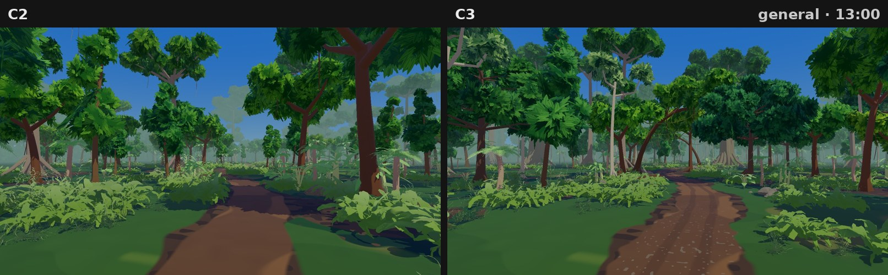
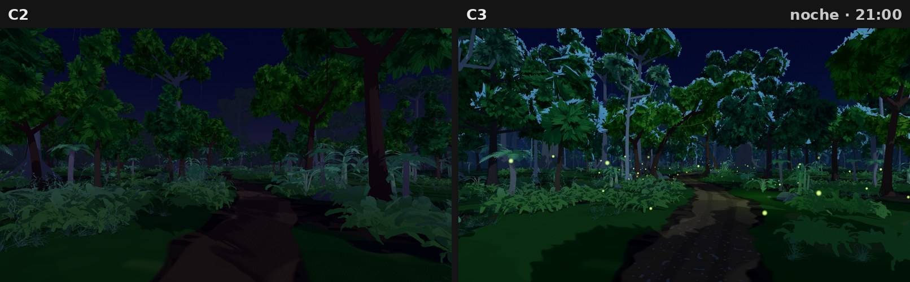
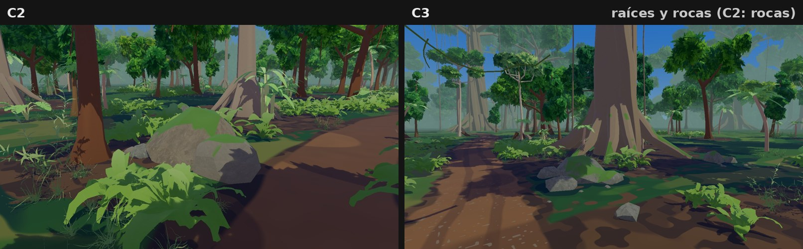
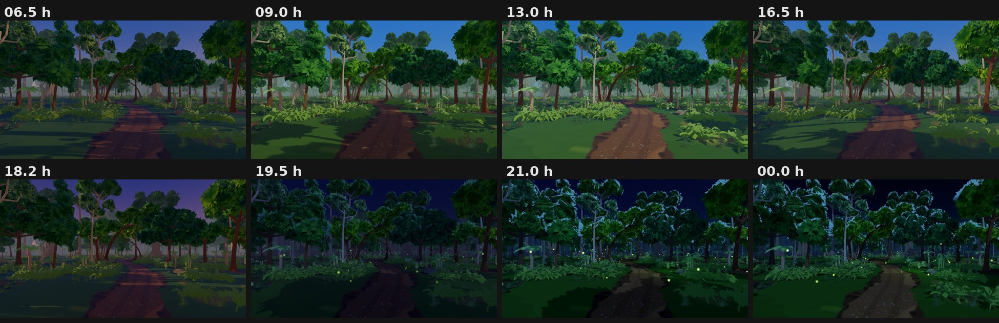

### C3.H Pruebas funcionales (Godot 4.7.2)
- **Suite completa `--mode=all`:** **317 de 317 correctas** ([pruebas_c3/resultado_pruebas_mode_all_472.txt](pruebas_c3/resultado_pruebas_mode_all_472.txt)). Son las 296 anteriores más **21 nuevas** de la C3. Las anteriores cubren los sistemas del juego: personajes, combate, diálogos, HUD, guardado y mundo.
- **Pruebas nuevas de la C3:**
  - **Carga y shaders:** la escena carga, los shaders de suelo y luciérnagas compilan, y no hay objetos de laboratorio.
  - **Árboles:** monumental de más de 25 m con raíces, pisos, cecropia e inclinado con su silueta, alturas distintas, 8 tipos en el bosque y MultiMesh.
  - **Primer plano y suelo:** plantas grandes fuera del camino y de las cámaras, raíces que no bloquean el centro del camino, y rocas en grupos.
  - **Noche:** luciérnagas y luces solo de noche, noche legible sin subir la exposición, y bruma más clara que el cielo.
  - **Personaje:** está en el camino, visible en el plano de escala y oculto en los demás.
  - **Rendimiento:** menos nodos de dibujo que la C2.
- **Ciclo día-noche:** probado a las 6:30, 9, 13, 16:30, 18:12, 19:30, 21 y 0 h, en capturas y en pruebas.
- **Consola de Forward+ durante las capturas:** sin errores de scripts, shaders ni recursos faltantes. Solo aparecen los avisos de audio ALSA (el contenedor no tiene tarjeta de sonido). Registro en [pruebas_c3/consola_capturas_forward_plus_472.txt](pruebas_c3/consola_capturas_forward_plus_472.txt).
- **Cámara del juego y gameplay:** no se han modificado. Las cámaras de la escena de prueba son encuadres fijos de evaluación.

### C3.I Problemas pendientes
- **Rendimiento en GPU real:** pendiente, como indicaste.
- **Triángulos:** la C3 tiene un 15 % más de triángulos que la C2, por el bosque más rico, los árboles monumentales, las raíces y las rocas, aunque hace un 20 % menos de llamadas de dibujo. Si en el PC hiciera falta, el siguiente paso sería un LOD del anillo lejano (variantes con menos racimos).
- **Encuadre de terreno:** a la derecha entra una copa cercana desde arriba. Se lee como marco natural, pero se puede despejar más si lo prefieres.
- **Copas de cerca:** el atlas de hojas sigue siendo procedural. Un atlas pintado a mano daría más carácter en primer plano.
- **Amanecer y atardecer:** siguen teniendo una paleta parecida, como ya anoté en la C2.
- **Sin integrar:** la C3 no está en el mundo principal, como pediste.

### C3.J Archivos
Nuevos:
- `scenes/pruebas/PruebaEntornoAnimeC3.tscn`
- `scripts/anime/prueba_entorno_c3.gd`
- `scripts/anime/selva_c3.gd`
- `assets/materials/anime/anime_suelo_selva_c3.gdshader`
- `assets/materials/anime/anime_luciernaga.gdshader`
- `tests/entorno_c3_tests.gd`

Modificados:
- `tests/e2e_director.gd`: ejecuta también las pruebas C3.
- `CHANGELOG.md`

Ningún archivo de la C2, la C1, la Etapa B ni el v13 cambió. El detalle está en [ARCHIVOS.md](ARCHIVOS.md).

Para abrir la escena: `res://scenes/pruebas/PruebaEntornoAnimeC3.tscn` (F6). Las teclas son:
- **1 a 8:** encuadres (el 8 es raíces y rocas).
- **H:** cambia la hora.
- **O:** activa o desactiva los contornos.
- **Esc:** vuelve al menú.

---

## Revisión C2

La C2 es una escena de prueba nueva y aislada, `scenes/pruebas/PruebaEntornoAnimeC2.tscn`. No toca la
escena C1, el laboratorio de la Etapa B, el juego ni el mundo principal. Con Tab se compara con el v13
en el mismo sitio, con la misma cámara y la misma hora: el v13 muestra sus árboles `ArbolSelva`, sus
rocas escaneadas y su material de terreno originales donde el estilo anime pone los nuevos.

**Validación con Godot 4.7.2** (4.7.2.stable.official.ed1daf0bf), la versión objetivo. La importación,
las pruebas, las capturas y la medición de la C2 se hicieron con esa versión. Ninguna prueba necesitó
otra versión. (La C1 se había validado con 4.7 stable porque entonces no tenía la 4.7.2 disponible.)

### C2.1 Copas: árboles de verdad, no esferas
- Se eliminaron las masas de copa esféricas de la C1. Los árboles de la C2 son **mallas nuevas**: tronco
  con ramas reales que salen de él, y la copa formada por **racimos de hojas** (tarjetas con una
  textura de hojas recortadas, en 4 variantes) agrupados al final de cada rama.
- Cada racimo tiene un tamaño, un aplastamiento y una orientación distintos, y las normales de la copa
  apuntan hacia fuera del racimo. Así la luz forma bandas de volumen (sol arriba, sombra fría abajo),
  pero el borde de la silueta queda recortado por hojas, no liso.
- Ninguna forma se repite: cada árbol se genera con su propia semilla. Hay 19 variantes, y al
  colocarlas se giran y escalan. Una prueba comprueba que dos semillas dan árboles distintos.

### C2.2 Bosque: densidad, especies y espacio jugable
- **Tres especies** con siluetas propias:
  - **Ceiba:** 16–22 m, raíces de tabla, ramas casi horizontales y copa ancha y plana.
  - **Árbol de copa redonda:** 5–8 m, tronco corto y ramas que suben.
  - **Árbol joven:** 6–9 m, delgado y con racimos apilados.
  - A esas tres se suman palmas, helechos arborescentes, plataneras y monsteras de la biblioteca.
- **Especies según la distancia al camino:** cerca dominan los árboles redondos, los jóvenes y las
  palmas. Lejos aparecen más ceibas.
- **Recuento:** 117 árboles cercanos (10 ceibas, 59 redondos y 48 jóvenes) y 20 palmas, con
  separación mínima por especie. Detrás hay un anillo de 190 árboles lejanos y una masa continua de
  copas en el horizonte.
- **Sotobosque en manchas:** helechos, hierbas altas, calatheas, anthuriums y arbustos se agrupan en las
  orillas del camino, al pie de los árboles y en los claros.
- **Zona jugable:** el camino serpenteante (2,6 m de ancho) y sus orillas quedan libres, igual que el
  primer plano de la cámara, así que la escena se lee como un recorrido jugable.

### C2.3 Terreno: zonas naturales sin manchas pastel
- Nuevo shader `anime_suelo_selva.gdshader`, sin texturas fotográficas y sin degradados difuminados.
  Las zonas tienen **borde definido**, roto por ruido a dos escalas para que no salgan discos ni
  manchas redondas.
- **Paleta natural** con variación controlada: tierra del camino en dos tonos, hojarasca (con hojas
  sueltas cerca de la cámara), musgo y charcos de humedad bajo las copas, y tres tonos de hierba
  (verde, claro y seco).
- El suelo se unifica hacia un verde de distancia para no hacer ruido a lo lejos. La malla tiene un
  relieve suave (unos 35 cm) y el camino va ligeramente hundido.

### C2.4 Rocas facetadas y asentadas
- Las rocas nuevas parten de una icosfera de pocas caras. Se recortan con **7 a 10 planos**, que dejan
  caras planas y aristas, y usan normales de cara, así que con las bandas de luz se ven los planos.
- Hay **tamaños variados**: rocas grandes de hasta unos 3 m de ancho, medianas, pequeñas y piedras sueltas. Se reparten
  en cinco grupos junto al camino y 14 piedras sueltas, 28 en total.
- **Base aplanada y hundida** un 12 % en el suelo.
- **Musgo solo en lo alto** de las rocas grandes de los grupos en sombra, con un verde oscuro.
- Las plantas no crecen encima de las rocas.

### C2.5 Horizonte sin franja azul
- El cielo anime tiene su horizonte mezclado con el color de la bruma. Además, el horizonte del suelo
  del cielo y la niebla son **exactamente el mismo color**, y hay una prueba que lo verifica.
- Detrás del bosque cercano hay **190 árboles lejanos** (entre 58 y 200 m) y una **masa continua de
  copas** a 175–235 m. Entre los troncos ya no se ve ni el cielo ni el final del suelo: la selva sigue
  hasta perderse en la bruma.
- La niebla de profundidad va de 22 a 160 m, con una perspectiva aérea suave.

### C2.6 Cielo e iluminación por hora
- La **tabla de luz anime** tiene 9 horas: 0, 5:30, 6:30, 9, 13, 16:30, 18:12, 19:30 y 24. Cada hora
  fija el cenit, el horizonte, la bruma, el color y la energía del sol, su altura y dirección, y el
  ambiente. Los valores intermedios se interpolan.
- **Mediodía:** cenit azul con saturación contenida (0,17 · 0,40 · 0,74). El sol entra en diagonal
  (58° de altura) para que haya sombras y volumen; con el sol cenital todo quedaba plano.
- **Atardecer y amanecer:** el cielo toma tonos cálidos y violetas, pero la luz del sol conserva el
  verde (≥ 0,7), así que la vegetación no se tiñe de rosa ni de amarillo.
- **Noche:** luz de luna azulada con energía 0,5 y ambiente 0,55. El camino, los troncos y el sotobosque
  se distinguen.
- Ajustes del entorno anime C2: ambiente de color en lugar de cielo, SSAO más marcado, saturación 1,06,
  contraste 1,1 y exposición 1,0.
- Hay capturas del ciclo completo en los dos estilos (ver C2.8).

### C2.7 Corrección de color encontrada en la C2
Los colores que se pasan a los materiales como `Vector3` llegan al shader **sin convertir de sRGB a
lineal**. Por eso en la C1 las rocas y las cortezas salían casi blancas y las copas, verde menta. En la
C2 los colores de copas, cortezas, rocas y musgo se convierten a lineal antes de pasarlos. Los
materiales de la Etapa B no se tocaron.

### C2.8 Capturas reales de Godot 4.7.2 (Forward+)
Son 28 capturas a 1600×900. Hay 7 encuadres al mediodía en los dos estilos, y el plano general a 7
horas más en los dos estilos. Todas salen de la escena de prueba con la cámara y la hora fijas: no son
renders externos, imágenes generadas ni retoques. Las láminas solo ponen dos capturas una al lado de
la otra. La escena no tiene esferas, tablones ni objetos de laboratorio, y el personaje solo aparece
en el plano de escala.

| Encuadre | Anime C2 | v13 | Comparación |
|---|---|---|---|
| Vista general | [anime](capturas_c2/c2_anime_general_h13_0.jpg) | [v13](capturas_c2/c2_v13_general_h13_0.jpg) | [lámina](comparaciones_c2/c2_comparacion_general_h13.jpg) |
| Profundidad (elevada) | [anime](capturas_c2/c2_anime_profundidad_h13_0.jpg) | [v13](capturas_c2/c2_v13_profundidad_h13_0.jpg) | [lámina](comparaciones_c2/c2_comparacion_profundidad_h13.jpg) |
| Copas | [anime](capturas_c2/c2_anime_copas_h13_0.jpg) | [v13](capturas_c2/c2_v13_copas_h13_0.jpg) | [lámina](comparaciones_c2/c2_comparacion_copas_h13.jpg) |
| Vegetación | [anime](capturas_c2/c2_anime_vegetacion_h13_0.jpg) | [v13](capturas_c2/c2_v13_vegetacion_h13_0.jpg) | [lámina](comparaciones_c2/c2_comparacion_vegetacion_h13.jpg) |
| Rocas | [anime](capturas_c2/c2_anime_rocas_h13_0.jpg) | [v13](capturas_c2/c2_v13_rocas_h13_0.jpg) | [lámina](comparaciones_c2/c2_comparacion_rocas_h13.jpg) |
| Terreno | [anime](capturas_c2/c2_anime_terreno_h13_0.jpg) | [v13](capturas_c2/c2_v13_terreno_h13_0.jpg) | [lámina](comparaciones_c2/c2_comparacion_terreno_h13.jpg) |
| Escala con el personaje | [anime](capturas_c2/c2_anime_escala_h13_0.jpg) | [v13](capturas_c2/c2_v13_escala_h13_0.jpg) | [lámina](comparaciones_c2/c2_comparacion_escala_h13.jpg) |
| Ciclo día-noche | [anime, 8 horas](comparaciones_c2/c2_ciclo_dia_noche_anime.jpg) | [v13, 8 horas](comparaciones_c2/c2_ciclo_dia_noche_v13.jpg) | 6:30, 9, 13, 16:30, 18:12, 19:30, 21 y 0 h |

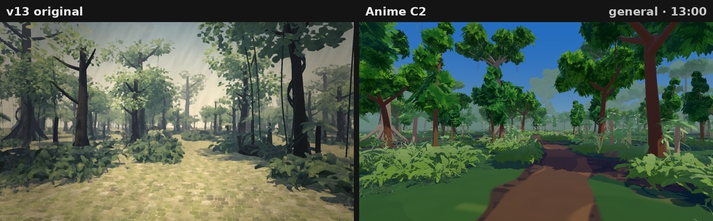
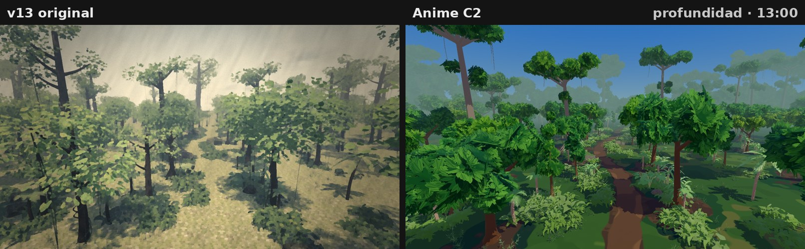
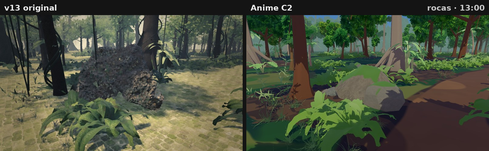
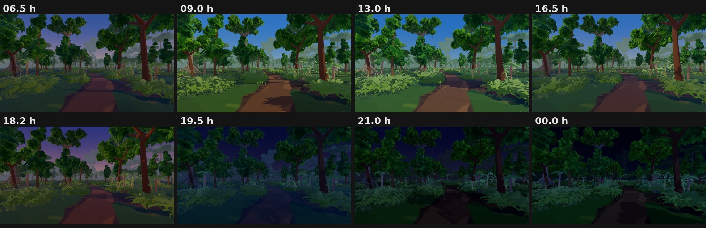

### C2.9 Validación técnica (Godot 4.7.2)
- **Pruebas automatizadas:** **296 de 296 correctas** en `--mode=all` (headless). Son las 276 anteriores más **20
  nuevas** de la C2, en [pruebas_c2/resultado_pruebas_mode_all_472.txt](pruebas_c2/resultado_pruebas_mode_all_472.txt).
  - Compilación de los shaders de copa y suelo.
  - Árboles de las tres especies con tronco y copa, alturas distintas y sin clones.
  - Rocas con normales hacia fuera, facetadas y con la base hundida.
  - Escena sin objetos de laboratorio, con las especies y el anillo lejano.
  - Horizonte sin franja azul, y suelo del cielo igual a la niebla.
  - Cielo de mediodía con saturación contenida, atardecer sin tinte rosa y noche legible.
  - Cambio de estilo v13 ↔ anime.
- **Consola de Forward+ durante las 28 capturas:** sin errores ni advertencias de scripts, shaders o
  recursos. Solo aparecen los avisos de audio ALSA, porque el contenedor no tiene tarjeta de sonido.
  Registro en [pruebas_c2/consola_capturas_forward_plus_472.txt](pruebas_c2/consola_capturas_forward_plus_472.txt).
- **Rendimiento:** medido con `-- --medir=20` sobre el plano general a 1600×900, sin límite de FPS
  ([pruebas_c2/rendimiento_medido_472.txt](pruebas_c2/rendimiento_medido_472.txt)):

  | Estilo | ms/fotograma | FPS | Llamadas de dibujo | Triángulos |
  |---|---|---|---|---|
  | v13 (mismo sitio, árboles y rocas v13) | 5805,49 | 0,17 | 638 | 2 881 429 |
  | Anime C2 | 4913,62 | 0,20 | 961 | 1 167 747 |

  **Entorno de la medición:** contenedor en la nube **sin GPU**, con Intel Xeon a 2,1 GHz (4 núcleos) y
  15 GB de RAM. Vulkan por software (Mesa llvmpipe, LLVM 20.1.2) en Xvfb, con Godot 4.7.2 stable
  oficial. Estos FPS **no representan un PC con tarjeta gráfica** y no deben usarse como cifra de
  rendimiento: solo sirven para comparar entre estilos en la misma máquina. En la misma escena, la
  versión anime dibuja **un 59 % menos de triángulos** que el v13 (los árboles escaneados del v13 son
  más pesados), pero hace **un 51 % más de llamadas de dibujo** (961 frente a 638), porque cada árbol
  procedural es una malla independiente.

### C2.10 Pendiente y limitaciones
- **Sin GPU real:** no se puede dar una cifra de FPS para un PC. Hay que medir `-- --medir=120` en el PC
  de destino. Los más de 300 árboles son mallas sueltas; si el coste lo pide, el siguiente paso sería
  agruparlos (MultiMesh por variante) o usar LOD para el anillo lejano.
- **Hojas muy cerca de la cámara:** con el renderizado por software, los helechos pegados a la cámara
  muestran algo de dentado en las hojas finas. En un PC con antialiasing debería verse más limpio; no
  lo he podido comprobar.
- **Atlas de hojas generado por código:** el racimo de hojas es una textura procedural. Una versión
  pintada a mano o modelada en Blender daría más carácter a las copas de primer plano.
- **Atardecer:** el amanecer (6:30) y el atardecer (18:12) comparten una paleta violeta muy parecida.
  Se podrían diferenciar más si quieres.
- **Sin integrar:** como pediste, nada de esto está en el mundo principal.

### C2.11 Cómo abrirla
Abre `res://scenes/pruebas/PruebaEntornoAnimeC2.tscn` y ejecútala (F6). Las teclas son:
- **Tab:** cambia entre v13 y anime.
- **1 a 7:** cambia el encuadre.
- **H:** cambia la hora.
- **O:** activa o desactiva los contornos.
- **Esc:** vuelve al menú.

Para capturas y medición:
```
godot --path . res://scenes/pruebas/PruebaEntornoAnimeC2.tscn -- --capturas=/ruta
godot --path . res://scenes/pruebas/PruebaEntornoAnimeC2.tscn -- --medir=120
```

---

## Versión C1 (primera entrega, conservada como referencia)

**Fecha:** 30 de octubre de 2026
**Base:** la copia de desarrollo de la Etapa B. La v13 entregada y su copia de seguridad siguen intactas.
**Estado:** sustituida por la revisión C2 (arriba); se conserva como referencia.

Todo el trabajo está en una escena de prueba nueva, `scenes/pruebas/PruebaEntornoAnime.tscn`. El juego, el
mundo jugable y el laboratorio de la Etapa B no cambian. En la escena, la tecla Tab alterna entre el
estilo v13 original y el estilo anime para comparar.

### 1. Resultado por área

#### Vegetación y árboles
- Se añadió un bosque de fondo con 2 árboles fijos y 14 repartidos con semilla fija. Usan las 8 variantes
  de `ArbolSelva` de la biblioteca, con tamaño y giro variados. El centro de la escena y el recorrido de la
  cámara quedan libres, para no tapar el espacio jugable.
- Cada árbol lleva 6 **masas de copa volumétricas**: esferas deformadas con lóbulos de ruido, en 6 tonos
  de verde, colocadas en el centro real de la copa (que se lee del GLB). La copa se lee como un volumen
  con bandas de luz y sombra, y no como hojas planas dispersas. Las hojas originales se mantienen alrededor
  para conservar el borde recortado.
- Las copas proyectan sombras grandes. Al mediodía dejan una sombra moteada sobre el suelo.

#### Rocas y superficies naturales
- Las rocas escaneadas usan ahora un color plano propio, sin la foto, y la línea de contorno solo en la
  silueta. Así desaparecen las motas y las líneas interiores.
- La roca grande (`V_boulder_01_0`) y el conjunto con musgo (`V_rock_moss_set_01_0`) tienen
  **microrrelieve de escaneo**: con el sombreado por bandas, cada bulto se convierte en una mota de luz o
  sombra. En la escena de prueba se **sustituyen** por rocas estilizadas en el mismo sitio. Los escaneos
  originales no se modifican.
- Se añadieron 7 rocas estilizadas procedurales: relieve suave a dos escalas, base aplanada y musgo como
  masa de color en la parte superior.

#### Terreno
- Se sustituyó el plano verde uniforme por una malla de 260 m con **parches de color por vértice**:
  musgo, hierba, hojarasca, tierra y zonas húmedas. Dentro de cada parche hay una variación de tono a dos
  escalas. No usa texturas fotográficas.
- El relieve es muy suave (unos 12 cm), así que el espacio jugable sigue leyéndose como plano.

#### Cielo e iluminación
- El estilo anime tiene un **cielo propio**, con una paleta por hora (9, 13, 16:30, 18:12 y 21 h)
  interpolada a lo largo del ciclo. El v13 conserva su cielo de siempre.
- **Mediodía:** el cenit es azul saturado y no blanco. Se subieron la saturación (1,16) y el contraste
  (1,06) sin subir la exposición, para evitar los blancos quemados.
- **Bruma de selva:** la niebla y el horizonte del suelo comparten un color verde grisáceo. Así el final
  del terreno no se ve como un mar azul ni como una franja. De noche, la bruma se oscurece con el cielo.

#### Materiales
Cada familia tiene una identidad propia:

| Material | Acabado |
|---|---|
| Madera (tablones, mimbre) | Color plano con la veta pintada (Etapa B) |
| Troncos (corteza) | Marrón rojizo, detalle pintado y musgo en masa |
| Roca | Gris neutro, sin foto, musgo arriba, contorno solo en la silueta |
| Tierra / suelo | Parches por vértice y bandas, sin textura |
| Copas | Masas en 6 verdes, con 3 bandas |
| Hojas y vegetación | Hojas recortadas con normales esféricas y translucidez (Etapa B) |

### 2. Capturas reales (Godot, Forward+)

Todas se tomaron con Godot desde la escena de prueba, con el viewport a 1600×900. No hay imágenes
generadas, retocadas ni renders externos. Las láminas de comparación solo colocan dos capturas una al
lado de la otra.

| # | Pedido | Archivo |
|---|---|---|
| 1 | Vista general del entorno | [capturas/anime_entorno_general_h16_5.jpg](capturas/anime_entorno_general_h16_5.jpg) |
| 2 | Primer plano de árboles y copas | [capturas/anime_copas_primer_plano.jpg](capturas/anime_copas_primer_plano.jpg) |
| 3 | Primer plano de vegetación | [capturas/anime_vegetacion_primer_plano.jpg](capturas/anime_vegetacion_primer_plano.jpg) |
| 4 | Primer plano de rocas | [capturas/anime_rocas_primer_plano.jpg](capturas/anime_rocas_primer_plano.jpg) |
| 5 | Vista del terreno | [capturas/anime_terreno.jpg](capturas/anime_terreno.jpg) |
| 6 | Iluminación de mediodía | [capturas/anime_iluminacion_mediodia_h13.jpg](capturas/anime_iluminacion_mediodia_h13.jpg) |
| 7 | Otra hora del ciclo | [capturas/anime_ciclo_atardecer_h18_2.jpg](capturas/anime_ciclo_atardecer_h18_2.jpg) y [capturas/anime_ciclo_noche_h21.jpg](capturas/anime_ciclo_noche_h21.jpg) |
| 8 | Comparación original frente a anime | [comparaciones/comparacion_general_h16_5.jpg](comparaciones/comparacion_general_h16_5.jpg), [comparaciones/comparacion_copas.jpg](comparaciones/comparacion_copas.jpg), [comparaciones/comparacion_mediodia_h13.jpg](comparaciones/comparacion_mediodia_h13.jpg) |

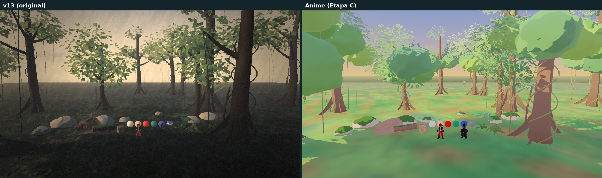
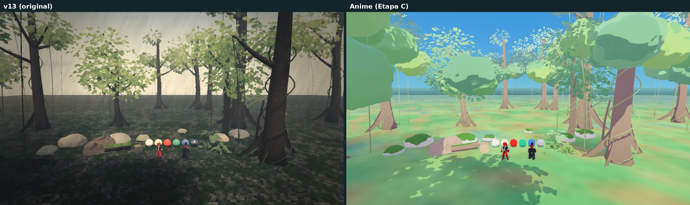
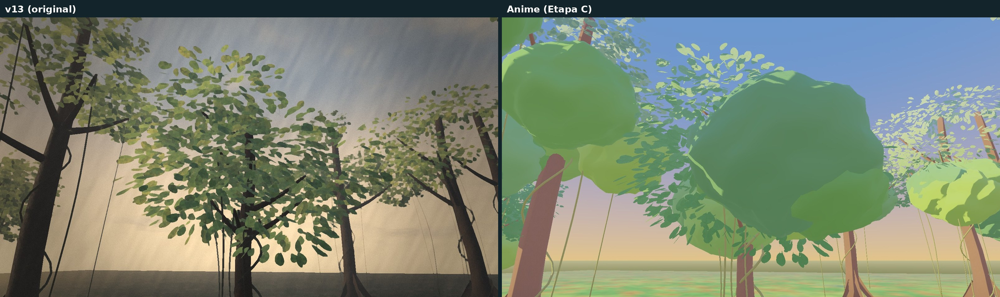

### 3. Validación técnica

- **Pruebas automatizadas:** 276 de 276 correctas en `--mode=all` (headless). Son las 266 anteriores
  (237 originales y 29 de la Etapa B) más **10 nuevas** del entorno: compilación del shader de suelo,
  orientación de caras del suelo, copas y rocas, montaje de la escena, cielo propio frente al del v13,
  azul de mediodía, noche más oscura y estilo v13 intacto. Registro completo en
  [pruebas/resultado_pruebas_mode_all.txt](pruebas/resultado_pruebas_mode_all.txt).
- **Carga de la escena:** carga sin errores de script en headless y en Forward+.
- **Ciclo día-noche:** funciona a las 13, 16:30, 18:12 y 21 h, tanto en las pruebas como en las capturas.
- **Consola de Forward+:** sin errores ni advertencias de scripts, shaders o recursos. Los únicos
  mensajes son los del audio ALSA, porque la máquina no tiene tarjeta de sonido y Godot pasa al
  controlador vacío. Registro en [pruebas/consola_capturas_forward_plus.txt](pruebas/consola_capturas_forward_plus.txt).
- **Rendimiento medido** con `-- --medir=120` sobre el encuadre panorámico a 1600×900, sin límite de FPS
  ([pruebas/rendimiento_medido.txt](pruebas/rendimiento_medido.txt)):

  | Estilo | ms/fotograma | FPS | Llamadas de dibujo | Triángulos |
  |---|---|---|---|---|
  | v13 | 1750,97 | 0,57 | 333 | 750 152 |
  | Anime (Etapa C) | 1029,76 | 0,97 | 394 | 909 690 |

  **Entorno de la medición:** contenedor en la nube sin GPU, con Intel Xeon a 2,1 GHz (4 núcleos) y 15 GB
  de RAM. Vulkan por software (Mesa llvmpipe, LLVM 20.1.2) en Xvfb, con Godot 4.7 stable oficial
  (5b4e0cb0f). Estos FPS **no representan un PC con tarjeta gráfica**: solo sirven para comparar entre
  estilos. Los valores útiles son el aumento de llamadas de dibujo (+18 %) y de triángulos (+21 %).
  El estilo anime sale más rápido aquí, probablemente porque el v13 activa el filtro pictórico
  Kuwahara, que es caro en CPU. Hace falta medir en un PC real.

### 4. Problemas detectados y soluciones

| Problema | Causa | Solución |
|---|---|---|
| El suelo nuevo no se veía y en su lugar aparecía el color del cielo | Godot toma como cara frontal el orden horario, y la malla se generó al revés | Se invirtió el orden de los triángulos. Una prueba comprueba las normales del suelo, las copas y las rocas |
| Al mediodía, el horizonte parecía un mar azul | El hemisferio inferior del cielo usaba el azul del horizonte | Bruma verde grisácea común a la niebla y al horizonte del suelo |
| Motas claras sobre las rocas | Microrrelieve de los escaneos con bandas de luz y sombra | Color plano, contorno solo en la silueta, y sustitución de los dos escaneos más ruidosos |
| Rocas pequeñas moteadas bajo los árboles | Sombra de las hojas recortadas sobre superficies pequeñas | Rocas nuevas fuera de la sombra de las copas |
| Suelo pastel y lavado | Paleta demasiado clara para la luz del atardecer | Paleta más oscura y saturación de 1,08 |

### 5. Limitaciones pendientes

- **Atardecer (16:30):** el suelo aún muestra manchas pastel rosadas y amarillas con la luz cálida, y se
  ve una franja clara donde termina el terreno. Hay que ajustarlo en la integración.
- **Masas de copa procedurales:** dan volumen y silueta, pero de cerca son superficies lisas. Para una
  copa con más carácter haría falta modelarla en Blender, con lóbulos esculpidos y borde de hojas.
- **Rocas:** las estilizadas tienen forma redondeada. Una roca de videojuego anime con planos más
  marcados también requiere modelado en Blender. Los dos escaneos sustituidos siguen sin usarse.
- **Versión de Godot:** pediste Godot 4.7.2. Este entorno tiene **Godot 4.7 stable** (la misma versión
  de todas las etapas anteriores), y las capturas se tomaron con esa versión.
- No se pudo medir el rendimiento en un PC con GPU real.

### 6. Cómo abrirla

Abre `res://scenes/pruebas/PruebaEntornoAnime.tscn` y ejecuta la escena (F6). Teclas: Tab cambia de
estilo, H cambia la hora, O activa o desactiva los contornos y Esc vuelve al menú. Los encuadres de la
Etapa C se usan en las capturas automáticas:

```
godot --path . res://scenes/pruebas/PruebaEntornoAnime.tscn -- --capturas=/ruta
godot --path . res://scenes/pruebas/PruebaEntornoAnime.tscn -- --medir=120
```

La relación completa de archivos está en [ARCHIVOS.md](ARCHIVOS.md).
